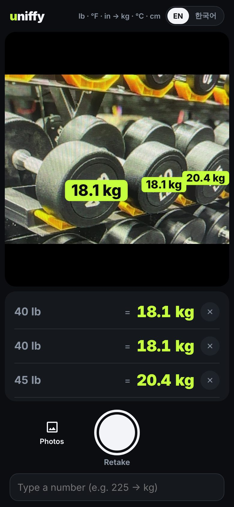
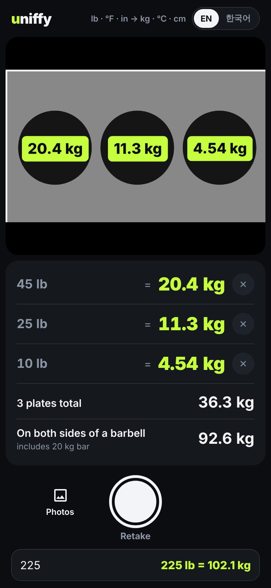
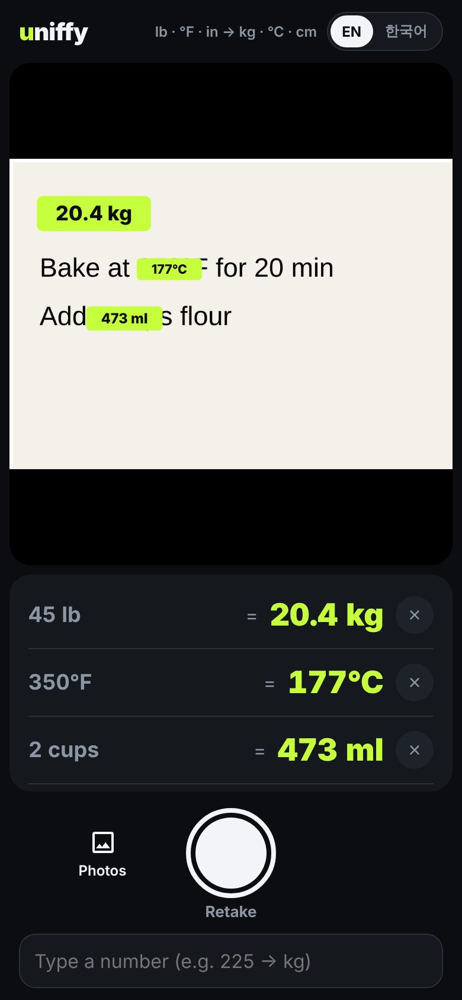

<h1 align="center">uniffy</h1>

<p align="center">
  <b>Point your camera at lb, °F or inches. See kg, °C and cm.</b><br />
  Made for gyms with pound plates and dumbbells, and for everyone who thinks in metric.
</p>

<p align="center">
  <a href="https://scrawl-labs.github.io/uniffy/"><b>Open the app →</b></a>
</p>

<p align="center">
  
  
  
</p>

## Features

- **Snap and read.** Converted values are drawn right on top of the original numbers.
- **Built for the gym.** Reads tilted and upside-down labels on dumbbells and plates. A bare `45` on a plate counts as pounds.
- **Barbell math.** Adds up the plates and shows the total with a 20 kg bar loaded on both sides.
- **Type it instead.** Enter `225` and get `102.1 kg`. `350f` and `5'11` work too.
- **Private and offline.** OCR runs on your phone, so photos never leave it. After the first load, it works with no signal.
- **English / 한국어.** Switch from the top-right corner.

Converts weight (lb, oz), length (in, ft, `5'11"`, yd, mi), temperature (°F), volume (cup, tbsp, tsp, fl oz, pt, qt, gal) and speed (mph). Ranges (`10-12 lb`) and fractions (`1 1/2 cups`) work too.

## How it works

1. [PaddleOCR](https://github.com/PaddlePaddle/PaddleOCR) (PP-OCRv4) runs in a Web Worker through ONNX Runtime WASM and finds where the text is.
2. Each text region is read at several rotations (30° steps, then ±15° around the best one), and the best reading wins. Number + unit beats a bare number. Implausible weights such as `408` (a misread `40 LB`) are rejected.
3. Readings are grouped by position, parsed into quantities, converted and drawn on the photo.

The first visit downloads about 30 MB of models. After that the service worker caches them.

## Development

```bash
npm install   # also copies OCR models + runtime into public/ocr
npm run dev
npm test
npm run build
```

Phone cameras only work over HTTPS, so test on a phone with the deployed site or a tunnel. Add `#debug` to the URL to log raw OCR readings.

Every push to `main` is tested, built and published to GitHub Pages by `.github/workflows/deploy.yml`.

## Project layout

```
src/units.ts       unit parsing and conversion
src/layout.ts      OCR words → positioned conversions; weight guessing; de-duplication
src/ocr.worker.ts  PaddleOCR worker: detect → read each region at several rotations → pick
src/ocr.ts         worker wrapper
src/i18n.ts        UI strings (en, ko)
src/main.ts        camera, overlay, UI
```
